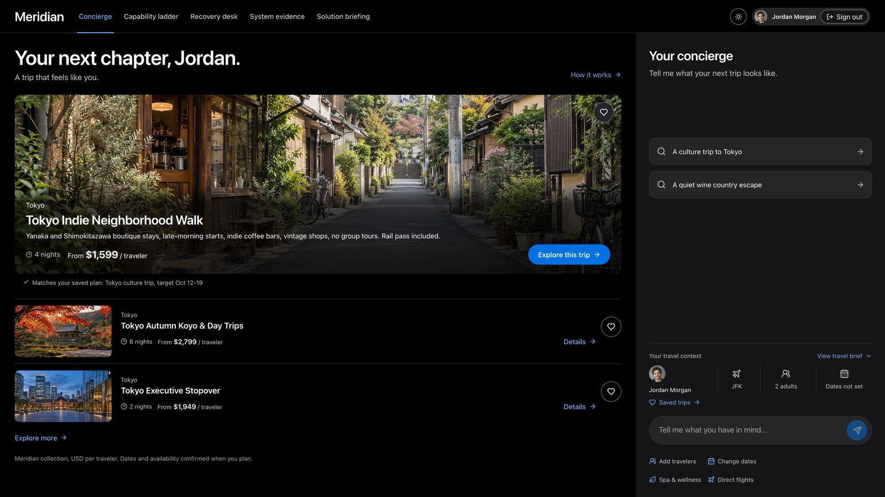
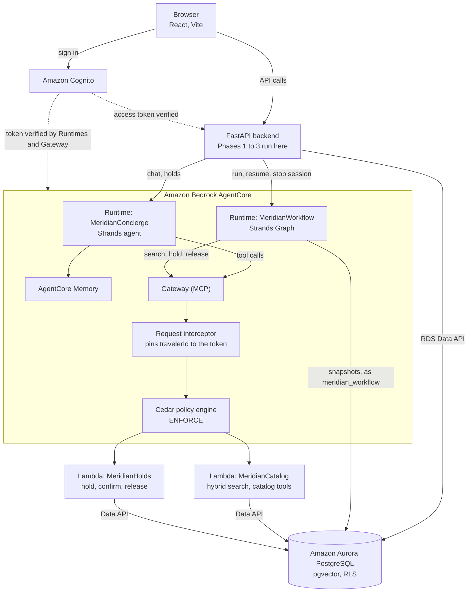

# Meridian: stateful agentic AI on Amazon Aurora, MCP and AgentCore

<p align="center">
  <a href="https://github.com/aws-samples/sample-stateful-agentic-ai-workflows-aurora-mcp-agentcore/actions/workflows/application-ci.yml"></a>
  <a href="LICENSE"></a>
  <a href="#prerequisites"></a>
  <a href="#prerequisites"></a>
  <br>
  <a href="https://aws.amazon.com/rds/aurora/"></a>
  <a href="https://aws.amazon.com/bedrock/agentcore/"></a>
  <a href="https://strandsagents.com"></a>
  <br>
  <a href="https://modelcontextprotocol.io"></a>
  <a href="https://aws.amazon.com/cognito/"></a>
  <a href="https://react.dev"></a>
  <a href="https://aws.amazon.com/cdk/"></a>
</p>

Reference code for an agent application that keeps its state in Amazon Aurora PostgreSQL,
reaches its tools through the Model Context Protocol (MCP), and runs as governed
workloads on Amazon Bedrock AgentCore.

<p align="center">
  
</p>

Meridian is a sample travel concierge. It grows in five phases: from SQL queries to MCP
tools, hybrid retrieval, a governed agent on AgentCore, and a Strands Graph workflow in its
own AgentCore Runtime that resumes after its session stops. Every screen shows the SQL,
tool calls, authorization decisions and stored records behind each answer.

The data is sample travel packages and one fictional traveler, Jordan Morgan. Holds and
confirmations change rows in Meridian's own database only. There is no supplier, airline or
payment integration.

## Contents

- [What you will see](#what-you-will-see)
- [Architecture](#architecture)
- [Prerequisites](#prerequisites)
- [Quick start](#quick-start)
- [Try the reference app](#try-the-reference-app)
- [Deploy to your account](#deploy-to-your-account)
- [Tests](#tests)
- [Repository layout](#repository-layout)
- [Documentation](#documentation)
- [Security](#security)
- [Contributing](#contributing)
- [License](#license)

## What you will see

Each phase adds one capability and keeps the earlier ones.

| Phase | Code | Adds |
| --- | --- | --- |
| 1. SQL | [phase_01_sql](meridian/backend/agents/phase_01_sql/) | Parameterized catalog queries through the RDS Data API |
| 2. MCP | [phase_02_mcp](meridian/backend/agents/phase_02_mcp/) | Named tools for search, package comparison, currency conversion, price range, region inventory and loyalty |
| 3. Retrieval | [phase_03_retrieval](meridian/backend/agents/phase_03_retrieval/) | Cohere Embed v4, pgvector and full-text candidates, Cohere Rerank 3.5 |
| 4. Production | [phase_04_production](meridian/backend/agents/phase_04_production/) | AgentCore Runtime, Gateway, Memory and Cedar policy, with traveler grants and row-level security (RLS) in Aurora |
| 5. Workflow | [phase_05_workflow](meridian/backend/agents/phase_05_workflow/) | A Strands Graph in its own AgentCore Runtime that searches, holds and releases through the Gateway, with Aurora snapshots, worker leases, idempotent holds and one audit row per run |

Each phase folder has a short guide with a sample prompt and the evidence to inspect.

Two terms recur. Strands is the open-source agent SDK that runs the agents and the workflow
graph. Cedar is the policy language that AgentCore Policy evaluates before a tool runs.

The sample keeps three kinds of state in Aurora or AgentCore:

| State | Where it lives |
| --- | --- |
| **Traveler context** | Profile, preferences and conversation history in Aurora. The agent session is in AgentCore Memory. |
| **Workflow progress** | Strands Graph snapshots in the Aurora table `workflow_snapshots`, appended after every node. |
| **Business results** | Holds and bookings in Aurora. A SQL function or a guarded update handles each action, so a retried request returns the first result. |

## Architecture



On your machine you run the backend and the frontend. In your AWS account you run Aurora,
the two AgentCore Runtimes, the Gateway, Memory and the two Lambda functions. Phases 1 to 3
call Amazon Bedrock models from the backend for embeddings, reranking and the Phase 3 agent.

Every hold, confirmation and release goes through the Gateway. Cedar checks each tool
call before a Lambda runs: the traveler must confirm, a hold lasts at most 12
hours for at most 6 travelers, the total must fit the saved budget, and a release
must name a hold and a journey. When a workflow step fails after its hold, the
workflow releases the hold through the Gateway, and the holds Lambda refuses the
release if another worker owns the run. Aurora RLS limits each query to one traveler. Read
[STATEFUL_ARCHITECTURE.md](meridian/docs/STATEFUL_ARCHITECTURE.md) for the
state design and [meridian/README.md](meridian/README.md) for the API, schema
and configuration.

Models on Amazon Bedrock: Claude Sonnet 5.5 for the agents, through its global
cross-Region inference profile, Cohere Embed v4 for embeddings and Cohere
Rerank 3.5 for reranking. `BEDROCK_MODEL_ID` changes the backend's Strands
agent; the managed Concierge runtime's model is set in
`meridian/meridian_agentcore/agentcore/agentcore.template.json`.

## Prerequisites

- Python 3.13 and Node.js 22.12 or later (CI runs Python 3.13 and Node.js 22)
- An AWS account with credentials (`aws login`, `aws sso login` or `aws configure`)
- Amazon Bedrock access to Claude Sonnet 5.5, Cohere Embed v4 and Cohere Rerank 3.5
- An Aurora PostgreSQL cluster with the RDS Data API enabled and a Secrets Manager secret for the database user. [OPERATIONS.md](meridian/docs/OPERATIONS.md#provision-aurora) shows how to create one with the included CDK app.
- For Phase 4, the Concierge chat and all holds: AgentCore resources, deployed with the [AgentCore CLI](https://github.com/aws/agentcore-cli) (`npm install -g @aws/agentcore`). See the [deployment runbook](meridian/docs/AGENTCORE_DEPLOY_RUNBOOK.md).

## Quick start

These steps run the backend and frontend on your machine against Aurora in your
account. Resources in your account incur charges while they exist. What you can run depends
on what you have deployed:

| You have | You can run |
| --- | --- |
| Aurora and Amazon Bedrock access | The catalog, Phases 1 to 3, System evidence and Solution briefing |
| Plus the AgentCore resources | The Concierge chat (Phase 4), the Phase 5 workflow, holds and confirmations |

### 1. Configure and prepare the database

```bash
cd meridian
python3.13 -m venv venv
source venv/bin/activate
python -m pip install --require-hashes -r requirements.txt
cp .env.example .env
```

In `.env`, set `AWS_DEFAULT_REGION`, `AURORA_CLUSTER_ARN`, `AURORA_SECRET_ARN`
and `AURORA_DATABASE`. For a new, empty database, run:

```bash
python scripts/init_aurora_schema.py
python scripts/apply_migrations.py
python scripts/seed_data.py
```

`seed_data.py` calls Amazon Bedrock to embed the catalog, so the credentials need Cohere
Embed v4 access. `init_aurora_schema.py` and `seed_data.py` refuse to run if Meridian tables or
data already exist. For an existing database, run only `apply_migrations.py`.

### 2. Start the backend

```bash
uvicorn backend.main:app --host 127.0.0.1 --port 8013
```

Phase 5 runs in the `MeridianWorkflow` AgentCore Runtime, not in this process.
The backend invokes it through `AGENTCORE_WORKFLOW_RUNTIME_ARN`, which
`python scripts/sync_agentcore_env.py --write` sets after you deploy. The
Runtime connects to Aurora as the `meridian_workflow` login created by
`scripts/provision_workflow_login.py`. See the
[deployment runbook](meridian/docs/AGENTCORE_DEPLOY_RUNBOOK.md).

In a second terminal, check the backend:

```bash
curl http://127.0.0.1:8013/api/health
```

The response has `"status": "healthy"` and `"aurora_reachable": true`. The snapshot
store fields keep their original key names, which say checkpoint:
`"checkpoint_backend": "Aurora workflow_snapshots"` and `"checkpoint_durable": true`.
`"workflow_runtime_configured"` is `false` until you deploy the AgentCore resources and run
`sync_agentcore_env.py --write`; that is expected for a local run. Local requests need no API
token. Read the [governance boundary](meridian/README.md#governance-boundary) before you
expose the API to a network.

### 3. Start the frontend

In another terminal, from the repository root:

```bash
cd meridian/frontend
npm ci
export VITE_API_ORIGIN=http://127.0.0.1:8013
npm run dev -- --host 127.0.0.1 --port 5176 --strictPort
```

Open <http://127.0.0.1:5176/showcase>. The header shows **Meridian live** when
`/api/health` reports healthy and the catalog and traveler profile reads work.

Without AgentCore resources, the Concierge chat, Phases 4 and 5 and all holds report
that AgentCore is not configured.

## Try the reference app

The showcase has five views along the top of the page.

1. **Concierge:** browse trips for Jordan without AgentCore. The chat and the hold and
   confirm buttons need AgentCore: ask, for example,
   `Find Tokyo trips that fit my saved preferences.` Open a trip, then use
   **Request 12-hour hold** and **Confirm this trip for Jordan**.
2. **Capability ladder:** pick a phase and run its suggested prompts. Open the
   activity trace under a reply to see the SQL, tool calls, retrieval scores and
   policy decisions. Turn on **Use traveler context** for Phase 4. Phases 4 and 5 need AgentCore.
3. **Recovery desk** (needs AgentCore): run the Phase 5 prompt
   `My JFK-to-Tokyo flight was canceled. Rework the trip, then check duration availability for the best three options.`
   The workflow pauses after a saved step, with a snapshot in Aurora. Select
   **Continue at recovery desk**, choose **Stop runtime session** on the
   continuity rail, then select **Resume and request hold**. The next resume
   starts a new microVM on the same session and continues on the same thread.
4. **System evidence:** read what Aurora recorded: snapshots, leases,
   session stops, authorization decisions and the hold. It shows these after a Phase 5 run,
   which needs AgentCore.
5. **Solution briefing:** the architecture, phases, Gateway tools and Cedar
   policies. It calls no service.

The full prompt list for each phase is in [meridian/README.md](meridian/README.md#prompts).
[OPERATIONS.md](meridian/docs/OPERATIONS.md#exercise-recovery-failures) has
scripts that stop a worker or discard a response on purpose.

## Deploy to your account

| Component | How | Guide |
| --- | --- | --- |
| Aurora cluster | CDK app `meridian/infra/bin/meridian-aurora.ts` | [OPERATIONS.md](meridian/docs/OPERATIONS.md#provision-aurora) |
| AgentCore Runtime, Gateway, Memory, policies | AgentCore CLI, from templates rendered for your account | [AGENTCORE_DEPLOY_RUNBOOK.md](meridian/docs/AGENTCORE_DEPLOY_RUNBOOK.md) |
| Hosted web app (CloudFront, S3, App Runner) | `meridian/scripts/publish.py`, for an existing App Runner service | [OPERATIONS.md](meridian/docs/OPERATIONS.md#publish-the-web-app) |

The AgentCore configuration is stored as templates with placeholders.
`python scripts/render_agentcore_config.py` fills in your account, Region and
resource IDs. See the [AgentCore project README](meridian/meridian_agentcore/README.md).
Each guide ends with teardown steps.

## Tests

```bash
# Backend (from meridian/, virtual environment active)
PYTHON_DOTENV_DISABLED=1 python -m pytest -m "not database"

# Frontend (from meridian/frontend/)
npm ci && npm run lint && npm run typecheck && npm run test:run
```

On every pull request CI runs ruff, the backend unit tests and `pip-audit`; the
frontend lint, typecheck, unit tests, build, `npm audit` and Playwright
accessibility tests; a backend container build with a network-less MCP import
check; the AgentCore CDK build, tests, format check and audit; and the web
infrastructure tests and audit. See [`application-ci.yml`](.github/workflows/application-ci.yml).

The unit tests block network access and ignore `meridian/.env`. Tests marked
`database` write snapshots, journeys and holds to a live Aurora database. Run
`python -m pytest -m database` only against a disposable database. See the
[dependency notes](meridian/docs/DEPENDENCIES.md) for the open audit finding.

## Repository layout

| Path | Contents |
| --- | --- |
| [`meridian/backend/`](meridian/backend/) | FastAPI app, phase agents, Aurora client, MCP servers |
| [`meridian/frontend/`](meridian/frontend/) | React showcase |
| [`meridian/meridian_agentcore/`](meridian/meridian_agentcore/) | AgentCore project: runtime code, Gateway Lambdas, templates, CDK app |
| [`meridian/infra/`](meridian/infra/) | CDK apps for Aurora and the hosted web app |
| [`meridian/scripts/`](meridian/scripts/README.md) | Schema, seed, migration, AgentCore and recovery scripts |
| [`meridian/examples/langgraph/`](meridian/examples/langgraph/) | A maintained second implementation of the workflow on another graph framework. The application does not import it |
| [`meridian/tests/`](meridian/tests/) | Pytest suite |
| [`meridian/docs/`](meridian/docs/README.md) | Architecture, operations and runbooks |

[meridian/STRUCTURE.md](meridian/STRUCTURE.md) traces a request through the code.

## Documentation

| Read | For |
| --- | --- |
| [meridian/README.md](meridian/README.md) | Screens, API, configuration, Aurora schema and governance boundary |
| [meridian/docs/README.md](meridian/docs/README.md) | Index of all documents |
| [meridian/backend/agents/README.md](meridian/backend/agents/README.md) | The five capability guides |
| [meridian/docs/STATEFUL_ARCHITECTURE.md](meridian/docs/STATEFUL_ARCHITECTURE.md) | Snapshots, memory, transactions and recovery |
| [meridian/docs/OPERATIONS.md](meridian/docs/OPERATIONS.md) | Provision Aurora, run locally, publish, recover, troubleshoot |
| [meridian/docs/AGENTCORE_DEPLOY_RUNBOOK.md](meridian/docs/AGENTCORE_DEPLOY_RUNBOOK.md) | Runtime, Gateway, Memory and Cedar deployment |
| [meridian/docs/CODE_WALKTHROUGH.md](meridian/docs/CODE_WALKTHROUGH.md) | The source, phase by phase |

## Security

Callers sign in with Amazon Cognito. In `jwt` mode the backend, both Runtimes
and the Gateway each verify the access token and take the traveler from its
`traveler_id` claim, never from a request body or a tool argument. Aurora
row-level security is the last check. `MERIDIAN_AGENTCORE_AUTH` selects the
mode: `jwt` carries the token through every hop, and `iam` (the default when
the variable is unset) signs the AgentCore hops with AWS credentials. Local
development keeps an open loopback mode and a shared API token path; a `jwt`
release refuses both. Review networking, monitoring, availability and data
protection before any production use.

To report a security issue, notify AWS/Amazon Security through the
[vulnerability reporting page](http://aws.amazon.com/security/vulnerability-reporting/).
Do not create a public GitHub issue. See
[CONTRIBUTING](CONTRIBUTING.md#security-issue-notifications).

## Contributing

See [CONTRIBUTING.md](CONTRIBUTING.md) and the [Code of Conduct](CODE_OF_CONDUCT.md).

## License

This library is licensed under the MIT-0 License. See the [LICENSE](LICENSE) file.
