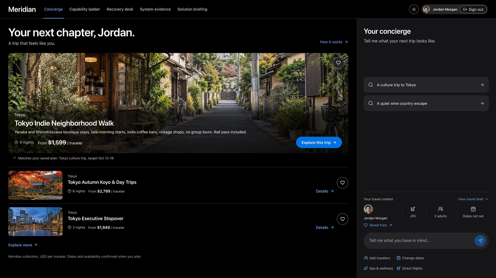
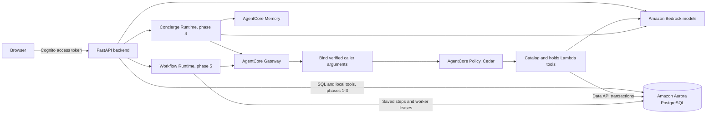

# Meridian: stateful agentic AI on Amazon Aurora, MCP and AgentCore

<p align="center">
  <a href="https://github.com/aws-samples/sample-stateful-agentic-ai-workflows-aurora-mcp-agentcore/actions/workflows/application-ci.yml"></a>
  <a href="LICENSE"></a>
  <a href="#prerequisites"></a>
  <a href="#prerequisites"></a>
  <br>
  <a href="https://aws.amazon.com/rds/aurora/"></a>
  <a href="https://aws.amazon.com/bedrock/agentcore/"></a>
  <a href="https://strandsagents.com"></a>
  <br>
  <a href="https://modelcontextprotocol.io"></a>
  <a href="https://aws.amazon.com/cognito/"></a>
  <a href="https://react.dev"></a>
  <a href="https://aws.amazon.com/cdk/"></a>
</p>

Meridian is a reference application for building stateful agentic AI workflows with
[Amazon Aurora PostgreSQL](https://aws.amazon.com/rds/aurora/), the
[Model Context Protocol (MCP)](https://modelcontextprotocol.io) and
[Amazon Bedrock AgentCore](https://docs.aws.amazon.com/bedrock-agentcore/latest/devguide/what-is-bedrock-agentcore.html).
You follow one travel request through five phases. It starts as a parameterized SQL query and
ends as a governed booking action. Then you stop a worker and watch the workflow resume from the
progress it saved in Aurora.

<p align="center">
  
</p>

The catalog and travelers are fictional. Holds and confirmations change rows in Meridian's own
database and nothing else. The recovery scenario starts with a traveler whose flight was
canceled. Meridian has no airline, supplier, payment or real reservation integration.

**Start here:** [What you learn](#five-phases) |
[**Explore the five phases without an AWS account**](meridian/docs/CODE_WALKTHROUGH.md) |
[Run locally](#quick-start) | [Try the app](#try-the-reference-app) |
[Deploy to your account](#deploy-to-your-account) | [Costs and cleanup](#costs-and-clean-up)

## Five phases

Each phase adds one capability to the same travel concierge. In the running app, the
**Capability ladder** view lets you run each phase and inspect what it did. The first two phases
run in code, with no model making a choice. The first model-driven agent appears in Phase 3.
Phase 5 runs a [Strands Agents](https://strandsagents.com) graph whose steps and route are fixed
in code.

| Phase | What you learn | Where to look |
| --- | --- | --- |
| **1. SQL** | How a parameterized query filters the catalog through the RDS Data API | [`sql_search` in chat.py](meridian/backend/routers/chat.py), and the SQL with its bound values in the activity trace |
| **2. MCP** | How the same business operations become named tools with typed inputs | [`mcp_search`](meridian/backend/routers/chat.py), the [MCP server](meridian/backend/mcp/concierge_server.py), and the tool arguments and returned records |
| **3. Retrieval** | How a Strands agent combines MCP reads with vector and full-text retrieval, then reranks the candidates | The [retrieval agent](meridian/backend/agents/phase_03_retrieval/), the [hybrid pipeline](meridian/backend/retrieval/hybrid.py), and the candidate and ranking spans |
| **4. Production** | How the Concierge agent moves to AgentCore Runtime, and how AgentCore Gateway, AgentCore Policy and AWS Lambda govern every tool it calls | The [backend adapter](meridian/backend/agents/phase_04_production/), the [Runtime](meridian/meridian_agentcore/app/MeridianConcierge/), Gateway refusals and committed booking receipts |
| **5. Workflow** | How a separate Runtime runs a Strands Graph with review pauses, saved steps, worker leases and recovery | The [workflow](meridian/backend/agents/phase_05_workflow/), `workflow_snapshots`, `journey_executions`, stable hold identities and action audit rows |

The Phase 1 and 2 agent definitions are reference examples. For those phases the app calls the
code paths in the table, not the agents. The [phase guides](meridian/backend/agents/README.md)
map every phase to its code.

## Explore without an AWS account

You can learn most of Meridian before you create anything in AWS. The
[code walkthrough](meridian/docs/CODE_WALKTHROUGH.md) follows one request through the five
phases. The unit tests run on your machine with no AWS credentials. Start with these three
places:

- **Where Aurora saves workflow progress.**
  [`snapshot_storage.py`](meridian/backend/agents/phase_05_workflow/snapshot_storage.py) appends
  each saved step to the `workflow_snapshots` table
  ([migration 014](meridian/scripts/migrations/014_workflow_snapshots.sql)).
- **Where the booking request gets its stable identity.**
  [`hold_intent.py`](meridian/backend/agents/phase_05_workflow/hold_intent.py) allocates the
  `hold_request_id` once and saves it before the hold runs, so a retry reuses it.
  [Migration 008](meridian/scripts/migrations/008_hold_request_identity.sql) enforces one hold per
  request inside the database.
- **Which test shows a paused workflow resuming.**
  [`test_workflow_graph.py`](meridian/tests/test_workflow_graph.py), starting with
  `test_a_new_graph_resumes_from_the_snapshot_and_holds_once`. In that test, a new graph over the
  same storage stands in for a restarted process. After the
  [backend install](#1-install-local-dependencies), run this from `meridian/`:

  ```bash
  PYTHON_DOTENV_DISABLED=1 venv/bin/python -m pytest -m "not database" tests/test_workflow_graph.py -k resumes
  ```

**Setting up AWS is a separate step and it costs money.** [Run locally](#quick-start) and the
[deployment](#deploy-to-your-account) create an Amazon Aurora cluster, call Amazon Bedrock and
deploy AgentCore resources. They bill for as long as they exist. Some of them, such as the Aurora
cluster, load balancers, secrets and logs, keep billing until you remove them. Read
[Costs and clean up](#costs-and-clean-up) before you create anything. Meridian is a reference
application for learning and evaluation, not a production service.

## Architecture

Meridian has one web backend, two agent Runtimes and one governed path to the tools. Phases 1
to 3 run inside the FastAPI backend. Phase 4 runs the Concierge agent in its own
[AgentCore Runtime](https://docs.aws.amazon.com/bedrock-agentcore/latest/devguide/what-is-bedrock-agentcore.html),
and Phase 5 runs the recovery workflow in a second one. Both Runtimes reach the tools only
through AgentCore Gateway.



The diagram shows the signed-in `jwt` configuration with
`MERIDIAN_GATEWAY_ENFORCEMENT=both`. In that configuration, each hop checks who the traveler is:

1. The FastAPI backend verifies the traveler's Amazon Cognito access token.
2. Each Runtime and the Gateway verify the same token again with their own JWT authorizer.
3. The Gateway's request interceptor binds `travelerId` and `verifiedSubject` to the token's
   claims, so the model cannot choose another traveler.
4. [AgentCore Policy](https://docs.aws.amazon.com/bedrock-agentcore/latest/devguide/policy.html)
   evaluates Cedar rules. Cedar is the policy language that checks that binding and the
   action's limits before a tool runs.
5. The holds Lambda checks its workload grant, pins the database transaction to that traveler and
   calls bounded SQL functions under row-level security (RLS).

### State and failure guarantees

Each row names a concern, how Meridian handles it, and the limit of that guarantee.

| Concern | Implementation | Boundary |
| --- | --- | --- |
| Traveler context | Aurora profiles, preferences and conversations. Concierge session context in AgentCore Memory | Conversation memory does not make business actions durable. |
| Saved progress | Strands Graph snapshots in `workflow_snapshots` | A failed snapshot write can cause the preceding step to run again. |
| Worker ownership | Expiring leases and execution checks | A replacement worker acquires ownership. A stale execution cannot commit its governed hold. |
| Duplicate holds | Stable `(journey_id, hold_request_id)`, unique constraints and committed-result lookup | Retry the same intent with the same ID. Reuse never extends its original expiry. A new intent requires new consent. |
| Inventory | Allocation and confirmation share a transaction-scoped advisory lock. Expiry is checked after waiting. | A late confirmation cannot reclaim seats already allocated to another hold. |
| Commit uncertainty | A lost commit reply returns an unknown outcome. The next attempt reads the saved result. | A transport error is not proof that an action failed. |
| Action evidence | `booking_action_audit` is inserted in the business transaction | The booking and its application audit record commit together. Service logs are needed to corroborate authorization. |

**Resuming a workflow and making an action idempotent solve different problems.** A saved step
avoids repeating completed computation. A stable request identity prevents a repeated action
from creating another booking when execution stops between the commit and the saved step.

The application's holds are database reservations only. When the traveler chooses **Hold** or
**Confirm** and approves the terms, the platform runs those exact terms through the Gateway. The model
only describes the result. Missing inventory, unknown packages and tool failures are reported as
they are, never as invented success.

### Retrieval boundaries

The hybrid pipeline merges vector and full-text candidates, reapplies shared catalog filters,
then reranks the surviving records. Missing catalog rows are dropped. Explicit minus terms in the
retrieval tool query, such as `Tokyo -nightlife`, apply to both candidate sources.
Natural-language preferences are relevance signals unless the code implements a matching
structured constraint. Ranking does not guarantee dietary, accessibility or other real-world
suitability.

### Database access

Application paths use the **RDS Data API**, which runs SQL over HTTPS with no database driver.
Each scoped transaction carries the same transaction ID, uses `SET LOCAL ROLE` and
transaction-local traveler settings, and commits or rolls back as one unit. HTTP connection reuse
is not an application-managed PostgreSQL connection pool. The
[hold transaction benchmark](meridian/docs/HOLD_TRANSACTION_BENCHMARK.md) times the same hold
through the Data API, RDS Proxy and a direct PostgreSQL connection.

Use the master login for schema administration only, because it bypasses RLS. Deployed services use
non-owner, `NOBYPASSRLS`, `NOINHERIT` logins. After migration 029, service roles cannot directly
insert, update or delete booking tables, and only `meridian_gateway` can execute the bounded
hold, confirmation and release functions. See
[service logins](meridian/docs/OPERATIONS.md#service-logins) for how to create each login.

## Prerequisites

You need the following before the [quick start](#quick-start). The local app runs on your machine
but calls live AWS services in your account, so read [Costs and clean up](#costs-and-clean-up)
first.

- Python and Node.js matching [`meridian/.python-version`](meridian/.python-version) and
  [`meridian/.nvmrc`](meridian/.nvmrc). Install Python dependencies from the hashed locks and Node
  dependencies with `npm ci`.
- AWS credentials for a sandbox account, and permission to provision the resources in the
  [operations guide](meridian/docs/OPERATIONS.md). Use `us-east-1`, the default in
  [`.env.example`](meridian/.env.example). Another Region needs the settings in the
  [runbook prerequisites](meridian/docs/AGENTCORE_DEPLOY_RUNBOOK.md#prerequisites).
- Amazon Aurora PostgreSQL with the RDS Data API, pgvector and Secrets Manager credentials.
- Amazon Bedrock access, in that Region, to the default models: Claude Sonnet 5.5 through its
  global inference profile `global.anthropic.claude-sonnet-5-5`, Cohere Embed v4
  (`cohere.embed-v4:0`) and Cohere Rerank 3.5 (`cohere.rerank-v3-5:0`). `BEDROCK_MODEL_ID`,
  `EMBEDDING_MODEL` and `RERANK_MODEL` in [`.env.example`](meridian/.env.example) change them
  for the backend. The Concierge Runtime reads its own `BEDROCK_MODEL_ID` from the
  [AgentCore template](meridian/meridian_agentcore/agentcore/agentcore.template.json).
  Confirm model availability and inference-profile permissions before you seed the database.
- Phases 4 and 5 require deployed AgentCore resources. Packaging uses `uv` and the pinned
  `@aws/agentcore` CLI specified in the [deployment runbook](meridian/docs/AGENTCORE_DEPLOY_RUNBOOK.md).
- For the signed-in mode, the supplied Amazon Cognito test-user seeding flow stores each password
  in AWS Secrets Manager and, on macOS, in the Keychain. On Linux or Windows, run
  `seed_cognito_users.py --apply --no-keychain` to keep the password in Secrets Manager alone.
  Without that flag, a non-macOS `--apply` stops before it changes anything. The release CLI
  itself runs through a pinned `npx`.

## Quick start

The quick start runs the web app on your machine against AWS resources in your account. It has
three steps. Phases 1 to 3 need the database from step 2. Phases 4 and 5 also need the
AgentCore deployment at the end of step 2.

### 1. Install local dependencies

From the repository root:

```bash
cd meridian
python3.13 -m venv venv
source venv/bin/activate
python -m pip install --require-hashes -r requirements.txt
test -e .env || cp .env.example .env
```

Set the Region, Aurora cluster, database and secret references in `.env`. Keep credentials and
account-specific configuration out of Git.

### 2. Prepare AWS resources and choose authentication

**Prepare the database.** Follow
[Prepare the database](meridian/docs/OPERATIONS.md#prepare-the-database). On an empty database,
initialize the base schema and list the pending migrations. Dry-run **one named migration**,
inspect its result, then apply that migration. Repeat until none are pending, then seed the
catalog.

```bash
python scripts/init_aurora_schema.py
python scripts/apply_migrations.py --pending
python scripts/apply_migrations.py --dry-run --only <first-pending-migration.sql>
python scripts/apply_migrations.py --only <first-pending-migration.sql>
python scripts/seed_data.py
```

`seed_data.py` calls Amazon Bedrock when preparing catalog embeddings.
`init_aurora_schema.py` and `seed_data.py` refuse a database that already has Meridian data.
Run without a flag, `apply_migrations.py` only lists the pending migrations and prints its usage.
Nothing applies without `--only`. `scripts/setup.sh` follows this route for a new database.

The listing leaves out migration 034, which creates the password-rotation roles. Add
`--with-rotation` only if you adopt [automatic rotation](meridian/docs/OPERATIONS.md#rotate-workload-passwords-automatically).
Existing installations run only named migrations and must follow the
[026-029 upgrade order](meridian/docs/BOOKING_FUNCTIONS_UPGRADE.md). Do not apply all four before
upgrading the running application.

**Provision the backend service login.** The launcher in step 3 needs it. Its password goes in
its own Secrets Manager secret, and `AURORA_BACKEND_SECRET_ARN` is written to `meridian/.env`.
It needs migration 018 applied (the migration step above) and `AURORA_CLUSTER_ARN` and
`AURORA_SECRET_ARN` set in `.env`. It is step 2 of
[Create the logins](meridian/docs/OPERATIONS.md#create-the-logins). The first command only
prints the plan. The second changes AWS.

```bash
python scripts/provision_service_logins.py --login backend
python scripts/provision_service_logins.py --login backend --apply \
  --i-understand-this-changes-aws --write-env
```

The launcher below selects the provisioned **backend service login** through
`AURORA_BACKEND_SECRET_ARN`. When launching Uvicorn directly instead, set that process's
`AURORA_SECRET_ARN` to the backend service secret, because the database client reads that
variable. Never launch application traffic with the master secret.

**Choose an identity mode.** `MERIDIAN_AGENTCORE_AUTH` selects how callers are identified.

| Mode | Use it for | Setup |
| --- | --- | --- |
| `iam` | Local exploration with a trusted workload and seeded traveler grants | Loopback backend, AWS credentials, explicit workload-to-traveler binding |
| `jwt` | The signed-in traveler and cross-traveler isolation walkthrough | Cognito, backend verification, JWT authorizers on both Runtimes and Gateway, request interceptor, Cedar binding policy and service logins |

> [!IMPORTANT]
> Use the signed-in `jwt` mode to get the full traveler identity boundary. The default `iam`
> mode authenticates workloads and trusts the traveler arguments they send. It does not give the
> same end-user guarantee.

**Deploy AgentCore for Phases 4 and 5.** Follow the
[runbook](meridian/docs/AGENTCORE_DEPLOY_RUNBOOK.md), then run
`python scripts/sync_agentcore_env.py --write` to write the returned `AGENTCORE_*` values to
`.env`. Without `--write` it prints them masked. A healthy database alone does not establish
that the Runtimes, Gateway or policies are ready.

### 3. Start the backend and frontend

Backend, from `meridian/` with the virtual environment active:

```bash
python scripts/run_local.py
```

Frontend, from a second terminal at the repository root:

```bash
cd meridian/frontend
npm ci
VITE_API_ORIGIN=http://127.0.0.1:8013 npm run dev -- --host localhost --port 5173 --strictPort
```

Open <http://localhost:5173/showcase>.

**Expected:** the showcase opens. `/api/health` and the UI's configuration indicators report
what is set up. `"workflow_runtime_configured"` is `false` until you deploy and synchronize the Workflow
endpoint. The snapshot store is reported as `"snapshot_store": "Aurora workflow_snapshots"`.

The local modes that skip sign-in or use a shared token are for loopback only. Use the signed-in
configuration for hosted access.

### Run from VS Code

After completing setup, choose **File > Open Workspace from File** in VS Code and open
[`meridian.code-workspace`](meridian.code-workspace). Install its recommended Python extensions,
then select **Meridian: local app** in Run and Debug and press **F5**.
The workspace starts Vite at `http://localhost:5173` and the backend on port 8013, then opens the showcase.
What you see depends on the identity mode:

| Mode | What F5 opens |
| --- | --- |
| `iam` (the default) | No sign-in form. With no Cognito settings in `frontend/.env.development.local` the frontend is an ungated build (it logs "Meridian is running as an ungated build: sign-in is not configured"), and the loopback backend treats your local browser as the sample traveler Jordan Morgan (`trv_meridian_demo`). The showcase opens directly. |
| `jwt`, with `VITE_COGNITO_DOMAIN` and `VITE_COGNITO_CLIENT_ID` set | The inline sign-in form. Enter a seeded email and password (Jordan Morgan or the decoy Jordan Lee) and choose **Sign in**. Everything you then see is that traveler's, and the identity pipeline checks the token at every hop. |

Credentials in the form go directly to Amazon Cognito over HTTPS. The launcher never embeds
them or signs you in automatically. Tokens stay in memory, so a page reload asks you to sign in
again.

`scripts/run_local.py` selects `AURORA_BACKEND_SECRET_ARN` for that process. It leaves the
administrator settings in `.env` unchanged, refuses to launch without the service secret, and
keeps the configured authentication mode. Local sign-in also needs the Cognito frontend settings
and the exact registered callback `http://localhost:5173/showcase`.

Use `localhost`, not `127.0.0.1`, in the browser, because Cognito treats them as different
callback URLs. A different host or port causes `redirect_mismatch`. Return to the registered
address and start sign-in again.

Use **Tasks: Run Task > Meridian: check local configuration** for an offline settings check.
Stop the debugger to stop the backend. Use **Tasks: Terminate Task > Meridian: frontend** to
stop Vite. Port conflicts fail with a clear error. The workspace assumes the macOS and Linux
`venv/bin/python` layout shown above. On Windows, select `venv\Scripts\python.exe` in the
workspace settings and launch configuration.

## Try the reference app

Open the showcase on your local or hosted site. Each view teaches one part of the design. Work
through them in this order.

| View | Exercise | Inspect |
| --- | --- | --- |
| **Capability ladder** | Run each phase's suggested prompts | SQL parameters, MCP arguments, retrieved IDs and ranking |
| **Concierge** | Find a trip, request a hold, then confirm it (Phase 4) | Exact terms, Gateway outcome and saved booking receipt |
| **Recovery desk** | Click **Start recovery** once for the canceled Tokyo flight, review the shortlist, choose **Stop runtime session**, then resume from the saved step (Phase 5) | Saved step, new execution, unchanged hold request ID and one booking |
| **System evidence** | Open the records for that journey | Snapshots, leases, access decisions and business rows |
| **Solution briefing** | Trace the application architecture | Where identity, policy, RLS and recovery apply |

The [prompt guide](meridian/README.md#prompts) gives the exact prompts. The
[failure exercises](meridian/docs/OPERATIONS.md#exercise-recovery-failures) intentionally stop
workers or lose replies. Run them only in a disposable environment. Capture evidence before a
test reset, because the administrative reset deletes selected bookings and their action audit
rows.

## Deploy to your account

Deploy in the order of the table: Amazon Aurora first, then the AgentCore resources, then the
optional hosted web app.

| Component | Entry point | Instructions |
| --- | --- | --- |
| Aurora | [`meridian/infra/bin/meridian-aurora.ts`](meridian/infra/bin/meridian-aurora.ts) | [Provision Aurora](meridian/docs/OPERATIONS.md#provision-aurora) |
| Runtime, Gateway, Memory and Policy | [AgentCore project](meridian/meridian_agentcore/) | [Deployment runbook](meridian/docs/AGENTCORE_DEPLOY_RUNBOOK.md) |
| Optional hosted web app, new account | The CDK app with `-c backendHost=express` | [Host the backend on Amazon ECS Express Mode](meridian/docs/OPERATIONS.md#host-the-backend-on-amazon-ecs-express-mode) |
| Optional hosted web app, existing App Runner service | [`scripts/publish.py`](meridian/scripts/publish.py). In `jwt` mode, publish with `--tighten` | [Publish the web app](meridian/docs/OPERATIONS.md#publish-the-web-app) |
| Existing installation upgrade | Migrations 026-029 and coordinated application release | [Booking functions upgrade](meridian/docs/BOOKING_FUNCTIONS_UPGRADE.md) |

**Hosting is optional.** The local app from the quick start uses the same AWS data and agent
services, so you can skip hosting and still run every phase. A hosted site serves the frontend
from Amazon S3 through Amazon CloudFront, which also routes the API to the backend container.

- **A new account hosts the backend on Amazon ECS Express Mode.**
  [App Runner stopped accepting new customers](https://aws.amazon.com/apprunner/) on 30 April
  2026. The CDK app adds the Express Mode path when it gets `-c backendHost=express`, and
  `publish.py` does not manage it. Express Mode keeps one task and one load balancer running
  until you remove it.
- **An account that already runs App Runner can keep it.** The repository does not create that
  service. The opt-in `MeridianWebService` stack describes it, so an account that already runs it
  can import it into CloudFormation
  ([Operations](meridian/docs/OPERATIONS.md#bring-the-app-runner-service-under-cloudformation)).
  Without `-c backendHost=express`, the App Runner path is unchanged.

Each hosting choice has its own teardown, listed under [Clean up](#clean-up).

## Costs and clean up

Amazon Aurora compute, storage and backups incur charges while provisioned. Model inference,
AgentCore, Lambda, logs, Secrets Manager and optional web hosting add usage or retained-resource
costs. Read each service's current pricing before provisioning. The repository does not enforce
an account spending limit.

### Cost planning table

Rates and meters were checked on **November 7, 2026**. Estimate in your target Region using the
linked pricing pages and [AWS Pricing Calculator](https://calculator.aws/). Model selection,
Runtime compute generation, traffic, session duration, storage and retention change the result.
The table excludes credits, free-tier allowances, discounts, taxes and support charges.

| Component | Usage to budget | Estimate and cost control |
| --- | --- | --- |
| [Aurora Serverless v2](https://aws.amazon.com/rds/aurora/pricing/) | ACU-hours for every instance, storage, backup storage and applicable I/O | Sum average ACUs x hours x the regional ACU rate. The template's nonzero 1-ACU floor does not auto-pause. Account separately for retained snapshots and any added readers. |
| [Bedrock models](https://aws.amazon.com/bedrock/pricing/) | Input/output tokens, embedding input and rerank queries/chunks | Measure actual model calls per journey, including retries and catalog seeding. Apply the selected model and inference-tier rates. A user turn can cause several model calls. |
| [AgentCore Runtime](https://aws.amazon.com/bedrock/agentcore/pricing/) | Metered CPU and memory consumption for both Runtimes | Use the rate for the deployed compute generation and observed session usage. Include review pauses and memory retention in measurements rather than pricing only model latency. |
| [AgentCore Gateway, Policy and Memory](https://aws.amazon.com/bedrock/agentcore/pricing/) | Tool discovery/calls, policy evaluations, conversation events and memory operations | Count each metered operation, including retries and discovery. Workflow snapshots live in Aurora. Concierge conversation memory is a separate AgentCore cost. |
| [Lambda](https://aws.amazon.com/lambda/pricing/) | Requests and duration x configured memory | Include targets, request interception and Cognito hooks. Bound timeout and concurrency. A denied tool call can still incur upstream authorization work. |
| [Cognito](https://aws.amazon.com/cognito/pricing/) and secrets | Monthly active users, selected Cognito tier, secret storage and API calls | Include service-login secrets and any configured messaging or security features. See [Secrets Manager pricing](https://aws.amazon.com/secrets-manager/pricing/). |
| [App Runner](https://aws.amazon.com/apprunner/pricing/) and optional hosting | Provisioned memory, active CPU, S3 storage/requests, CloudFront traffic and container images | Local web serving avoids hosted web costs, but still uses AWS data and agent services. App Runner's provisioned memory can incur idle charges. See [S3](https://aws.amazon.com/s3/pricing/), [CloudFront](https://aws.amazon.com/cloudfront/pricing/) and [ECR](https://aws.amazon.com/ecr/pricing/). |
| [CloudWatch](https://aws.amazon.com/cloudwatch/pricing/) and networking | Log/trace ingestion, retention, queries, alarms and data transfer | Set retention and sampling deliberately. Include NAT gateways, endpoints or cross-Region transfer only if your chosen topology adds them. |

**Compute-only illustration.** The template's Aurora Standard writer and reader in US East
(N. Virginia), each held at its 1 ACU floor for 730 hours, at the published $0.12/ACU-hour
example rate, cost `2 x 1 x 730 x $0.12 = $175.20` a month. This is not the full application
price or an upper bound. It excludes scaling above the floor and every other row in the table.
See the [Aurora pricing example](https://aws.amazon.com/rds/aurora/pricing/).

Create budget alerts and resource tags before provisioning, then compare measured usage with
the estimate after a representative test run. Budget alerts do not stop spending. Retained
backups, logs, secrets and images can continue to incur charges after compute is removed.

### Clean up

Remove resources in reverse dependency order using the runbooks. The order matters for three
reasons. A managed policy cannot be deleted while a role still has it attached. A
CloudFormation export cannot be deleted while another stack imports it. The Express service
keeps a task and a load balancer running until its stack is gone.

1. The hosted web application, if created. Each hosting choice has its own teardown, so use only
   the one you deployed (or both, if you deployed both):
   - Express Mode (the path for a new account):
     [Tear down an Express-only deployment](meridian/docs/OPERATIONS.md#tear-down-the-express-backend).
     The site goes before the service, and the service before its roles. Then check that the
     service and its load balancer are gone.
   - App Runner: [Publish the web app](meridian/docs/OPERATIONS.md#publish-the-web-app), its last
     teardown paragraph.
2. [AgentCore resources](meridian/docs/AGENTCORE_DEPLOY_RUNBOOK.md#tear-down), including separately
   provisioned targets and secrets. Do this before the logins. The `MeridianWorkflow` Runtime's
   role attaches `MeridianWorkflowAuroraAccess` (the AgentCore template names it), the catalog
   Lambda's role attaches `MeridianCatalogAuroraAccess`, and a policy with an attached role cannot
   be deleted.
3. [Sign-in resources and service-login integrations](meridian/docs/OPERATIONS.md#roll-back-the-service-logins-and-sign-in).
   By now nothing attaches `MeridianBackendAuroraAccess` (the web roles were removed in step 1).
4. [Audit export](meridian/docs/OPERATIONS.md#audit-export), if you enabled it. Stop its schedule
   before you retire Aurora, so it does not keep reading a database that is going away. The stack
   never deletes the audit bucket (the `BucketName` output), its KMS key or the export Lambda's log
   group. They stay in your account and keep costing storage until Object Lock retention ends and
   you delete them yourself.
5. [Aurora](meridian/docs/OPERATIONS.md#provision-aurora), preserving a final snapshot until you no longer need the data.
6. CDK bootstrap. The `CDKToolkit` stack holds any backend images CDK pushed. Delete it
   only if nothing else in the account and Region deploys with CDK, and empty its S3 bucket
   and Amazon ECR repository first if the delete stops on them. Do not remove shared
   infrastructure as part of this application's cleanup.

Review retained snapshots, log groups, secrets, S3 objects and images afterward. The
dependency order above follows the stack definitions in `meridian/infra/lib` and
`meridian/meridian_agentcore/agentcore/cdk`. It was not rehearsed in a disposable account.

## Tests and evidence

### Run the offline tests

These tests need no AWS account and no credentials.

Backend, from `meridian/`:

```bash
venv/bin/python -m pip install --require-hashes -r requirements-ci.txt
venv/bin/python -m pip install --require-hashes --no-deps -r requirements-runtime-tests.txt
venv/bin/python -m pip install --require-hashes -r examples/langgraph/requirements.txt
PYTHON_DOTENV_DISABLED=1 venv/bin/python -m pytest -m "not database" tests examples/langgraph/tests
```

The unit-test guard blocks TCP connections and supplies fake AWS credentials. Tests marked
`database` access a configured live Aurora cluster and can write data, so leave them out of an
offline check.

Frontend, from `meridian/frontend/`, one command at a time. If `npm` or `npx` is a shell alias
that contains a `;`, a chained `&&` hides a failed step, so run each command on its own line.

```bash
npm ci
npm run lint
npm run typecheck
npm run test:run
npm run build
npx playwright install --with-deps chromium
npm run test:accessibility
```

`npm run test:accessibility` drives Chromium through Playwright, and a fresh machine has no
Chromium. Without the `playwright install` step, the run stops with a missing-executable error.
That line is the one CI runs. `--with-deps` also installs the operating-system libraries Chromium
needs on Linux, which takes root (it uses `apt`). On macOS and Windows, use
`npx playwright install chromium`, which downloads the browser into Playwright's cache. On
Linux without root, install the libraries with your package manager first.

The [CI workflow](.github/workflows/application-ci.yml) also checks infrastructure synthesis,
dependency advisories and each Runtime's exact dependency environment. The isolated
[`check_runtime_contract.py`](meridian/scripts/check_runtime_contract.py) exercises real MCP
stdio and Strands saved-step recovery without AWS. The backend lock alone does not test the
Runtime's MCP override.

### Live database tests

This part matters only if you run the `database` tests against your own cluster. They give back
the holds they place and keep every booking, hold request, journey and audit row, because an
audit export may already hold them. Two of them confirm a booking
(`test_the_holds_lambda_places_and_confirms_a_hold_as_the_least_privilege_login` and
`test_release_hold_leaves_a_confirmed_booking_alone`). Each run leaves one confirmed booking for one
or two travelers, which uses package places for good. The tests pick the package with the most
places left to spread that cost. Capacity comes back only through
`scripts/release_demo_bookings.py --delete-from-disposable-database` on a disposable database, or by
raising availability, so run them against a shared database sparingly. `scripts/validate_demo.py`
works the same way. Its confirmation step leaves one confirmed booking for one traveler, on the
roomiest package the traveler's budget covers.

Audit rows are never deleted, so a few remain. `test_workflow_audit_aurora` writes two
`agent_audit_log` rows per run for the sample traveler Jordan Morgan, under a unique `sub-test-`
subject. It cannot use another traveler, because the workflow login's audit write is authorized
for the travelers it is bound to, and that is what the test proves. `test_migration_033_live`
writes one `traveler_access_audit` deny row per run for a synthetic traveler,
`trv_itest_synthetic`, so it does not touch the sample traveler.

### What the evidence proves

**Evidence has different strengths.** UI spans and `agent_audit_log` are application reports. A
hard-killed process may never write its final turn row. A workflow that finds an existing
committed result need not call the target again or create another action row.
`booking_action_audit` commits with the action and carries caller, workload, request and service
correlation IDs. It is not a service-issued Cedar decision. Correlate it with the Gateway,
interceptor and Lambda logs and with the stored booking. Administrators can still alter database
records.

The [booking functions upgrade](meridian/docs/BOOKING_FUNCTIONS_UPGRADE.md#acceptance-matrix)
lists the live checks for an upgraded installation and their expected outcomes.

## Production implementation, scalability and operational resilience

Read this before you adapt Meridian for real traffic. Meridian implements production
mechanisms, but it is not a capacity certification or a complete production operating model. Set service-level objectives, recovery point and recovery
time objectives, and an expected traffic profile before adapting it for customer workloads.

| Area | Implemented here | Production work to complete |
| --- | --- | --- |
| Identity and least privilege | JWT validation at backend, Runtimes and Gateway; trusted argument binding; Cedar; service logins and transaction-scoped RLS; booking writes only through functions whose owner RLS also binds | Use your identity lifecycle and tenant model. Turn on and prove credential rotation: [alternating-users rotation](meridian/docs/OPERATIONS.md#rotate-workload-passwords-automatically) for the workload logins is in the repository, off by default and not yet run against a live cluster. Restrict direct Lambda invocation and service-secret access, which sit outside the traveler-facing boundary. Re-run cross-traveler and direct-access tests after IAM or policy changes. |
| Horizontal scaling | Separate hosted backend and Runtimes; Aurora snapshots and leases coordinate workflow attempts | Load-test concurrent journeys and hot inventory keys; the [read-only load test](meridian/docs/OPERATIONS.md#load-test) records only a low-rate latency baseline. Match App Runner or ECS Express Mode scaling, Runtime quotas and Lambda concurrency to database and model capacity. An SDK HTTP pool is not a PostgreSQL pool or a capacity reservation. |
| Database capacity | One Serverless v2 writer and one failover reader whose zone you verify against the writer's (see [First deployment: place the reader](meridian/docs/OPERATIONS.md#first-deployment-place-the-reader)), 1-16 ACUs, in the supplied CDK template; workload logins bounded by statement, lock and idle-transaction timeouts; shared inventory locks prevent oversubscription | Measure query latency, lock waits, ACU utilization and Data API throttling. Tune vector/full-text indexes and candidate limits using representative data. Test writer failover and resume under load. The Data API reaches only the writer, so read scaling needs a driver or an RDS Proxy read-only endpoint. |
| Retries and backpressure | Bounded retries, stable action IDs, committed-result lookup, worker leases and fenced writes | Apply admission limits per tenant and workload. Retry only transient failures with a bounded budget; preserve the same business intent on ambiguous commits. Do not turn a timeout into a new booking request. |
| Long-running work | Streamed responses, saved progress and explicit outcome readback | Treat HTTP disconnection as loss of observation. Work after a web request is best effort; persist required follow-up work durably. Test scale-in, expired caller tokens, lost replies and failed snapshot writes under load. |
| Availability and disaster recovery | Encrypted Aurora storage, deletion protection, seven-day backup retention and a failover reader in the template, whose zone you verify against the writer's | Restore into an isolated environment and measure recovery time. Test writer failover and resume with the original IDs. Define regional recovery and backup retention for your business; this sample does not implement cross-Region recovery, and a [written plan](meridian/docs/OPERATIONS.md#recover-in-another-region) covers what to build and the one blocker it found. |
| Observability and audit | Health checks, application traces, service correlation IDs, transactional action audit and best-effort turn summaries. An optional export copies the three audit tables every five minutes to an S3 bucket with Object Lock as a SHA-256 hash chain, through a read-only login, with alarms and a read-only verifier | Set alarms and owners for error rate, latency, throttling, lease age, snapshot failures and unresolved action outcomes. Correlate application records with native service logs. Deploy the export, choose its Object Lock mode and retention, keep the bucket in an account the database's administrators do not control, and record chain heads elsewhere. Rows changed before the next export window, master-user actions before export, a row that commits behind the watermark and removal of the newest objects are not covered; rows in Aurora alone are not tamper-proof evidence. |
| Agent tool choice | The model picks read tools from their descriptions and the prompt; a write needs the traveler's confirmation and Cedar, and Phase 5 reaches a hold only with a typed recovery intent from the UI. An offline tool-choice evaluation set, with a recorded baseline, measures the picks | Run the offline set before you change a prompt or a tool description. In production, turn on AgentCore Evaluations' tool selection and parameter evaluators on sampled sessions and alarm on their scores. Treat the model's choice as probabilistic: authorization, not the prompt, decides what can happen. |
| Safe releases | Hashed dependencies, CI, staged Runtime bundles, migration sequencing, deployment readback and failure proofs | Use separate environments, reviewed changes, a maintenance procedure and measured rollback criteria. Follow the 026-029 cutover order; old writer code is incompatible with the final revoked grants. |

The current write path has two deliberate serialization points. One worker is active per
workflow thread, and writes lock the relevant inventory keys. Adding workers can increase
independent journey throughput, but it cannot remove contention for the same seats. Measure p95/p99 latency,
success and refusal rates, token usage and cost per completed journey before increasing limits.
No requests-per-second or concurrent-user target has been established by the functional tests.

For operational procedures, use [waits, retries and readback](meridian/docs/OPERATIONS.md#waits-retries-and-readback),
the [stateful architecture](meridian/docs/STATEFUL_ARCHITECTURE.md), and the
[upgrade and failure matrix](meridian/docs/BOOKING_FUNCTIONS_UPGRADE.md#acceptance-matrix). For an unknown action outcome,
look up the original intent and booking first. Capture evidence before an administrative reset.
Resetting a booking deletes its associated action audit and is not a recovery procedure.

## Documentation

| Guide | Purpose |
| --- | --- |
| [Code walkthrough](meridian/docs/CODE_WALKTHROUGH.md) | One request through the five phases, with no AWS account needed |
| [Application README](meridian/README.md) | Screens, prompts, API and configuration |
| [Code structure](meridian/STRUCTURE.md) | Request paths and module responsibilities |
| [Stateful architecture](meridian/docs/STATEFUL_ARCHITECTURE.md) | Memory, saved progress and transactions |
| [Operations](meridian/docs/OPERATIONS.md) | Provisioning, deployment, recovery and teardown |
| [Booking functions upgrade](meridian/docs/BOOKING_FUNCTIONS_UPGRADE.md) | Migration order, acceptance matrix, rollback and test reset |
| [Documentation index](meridian/docs/README.md) | All supporting guides |
| [Persistence and pause/resume example](meridian/examples/langgraph/) | Another graph framework saving its state in Aurora and resuming a paused graph. It is not the governed workflow, which is Meridian's Strands path. The application does not import it, and the [offline test block](#run-the-offline-tests) installs its requirements |

## Security and contribution

Review the [governance boundary](meridian/README.md#governance-boundary) before exposing the API.
RLS constrains database roles and transaction scope. It does not cryptographically authenticate
a JWT. Direct access to privileged Lambda invocation, service credentials or the master login
is a separate administrative trust boundary.

Report security issues through the [AWS vulnerability reporting page](https://aws.amazon.com/security/vulnerability-reporting/),
not a public issue. For contributions, see [CONTRIBUTING.md](CONTRIBUTING.md) and the
[Code of Conduct](CODE_OF_CONDUCT.md).

## License

MIT-0. See [LICENSE](LICENSE). Third-party images and icons retain their own terms in [NOTICE](NOTICE).
