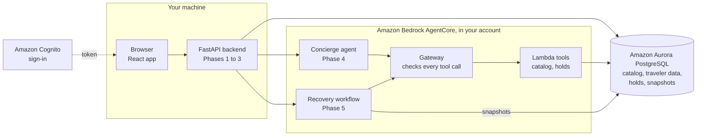

# Meridian: stateful agentic AI on Amazon Aurora, MCP and AgentCore

<p align="center">
  <a href="https://github.com/aws-samples/sample-stateful-agentic-ai-workflows-aurora-mcp-agentcore/actions/workflows/application-ci.yml"></a>
  <a href="LICENSE"></a>
  <a href="#prerequisites"></a>
  <a href="#prerequisites"></a>
  <br>
  <a href="https://aws.amazon.com/rds/aurora/"></a>
  <a href="https://aws.amazon.com/bedrock/agentcore/"></a>
  <a href="https://strandsagents.com"></a>
  <br>
  <a href="https://modelcontextprotocol.io"></a>
  <a href="https://aws.amazon.com/cognito/"></a>
  <a href="https://react.dev"></a>
  <a href="https://aws.amazon.com/cdk/"></a>
</p>

Reference code for an agent application that keeps its state in Amazon Aurora PostgreSQL,
reaches its tools through the Model Context Protocol (MCP), and runs as governed
workloads on Amazon Bedrock AgentCore.

<p align="center">
  
</p>

Meridian is a sample travel concierge for one fictional traveler, Jordan Morgan. Ask it for
trips, let it remember Jordan's preferences, place a 12-hour hold, then cancel a flight and watch
it rework the trip without placing a second hold. Every screen shows the SQL, tool calls,
authorization decisions and stored records behind each answer, so you can see how the pieces fit.

The code grows in five phases, and each phase keeps what came before: SQL queries, then MCP
tools, then hybrid retrieval, then a governed agent on AgentCore, then a Strands Graph workflow
in its own AgentCore Runtime that resumes after its session stops.

The data is a small catalog of sample travel packages. Holds and confirmations change rows in
Meridian's own database only. There is no supplier, airline or payment integration.

**Jump to:** [Architecture](#architecture) | [Quick start](#quick-start) | [Try it](#try-the-reference-app) | [Deploy](#deploy-to-your-account) | [Tests](#tests) | [Docs](#documentation)

## What you will see

Each phase adds one capability and keeps the earlier ones. Each phase folder has a short guide
with a sample prompt and the evidence to inspect.

| Phase | Code | Adds |
| --- | --- | --- |
| 1. SQL | [phase_01_sql](meridian/backend/agents/phase_01_sql/) | Parameterized catalog queries through the RDS Data API |
| 2. MCP | [phase_02_mcp](meridian/backend/agents/phase_02_mcp/) | Named tools for search, package comparison, currency conversion, price range, region inventory and loyalty |
| 3. Retrieval | [phase_03_retrieval](meridian/backend/agents/phase_03_retrieval/) | Cohere Embed v4, pgvector and full-text candidates, Cohere Rerank 3.5 |
| 4. Production | [phase_04_production](meridian/backend/agents/phase_04_production/) | AgentCore Runtime, Gateway, Memory and Cedar policy, with traveler grants and row-level security (RLS) in Aurora |
| 5. Workflow | [phase_05_workflow](meridian/backend/agents/phase_05_workflow/) | A Strands Graph in its own AgentCore Runtime that searches, holds and releases through the Gateway, with Aurora snapshots, worker leases, idempotent holds and one audit row per run |

Strands is the open-source agent SDK that runs the agents and the workflow graph. Cedar is the
policy language that AgentCore Policy evaluates before a tool runs.

| State | Where it lives |
| --- | --- |
| **Traveler context** | Profile, preferences and conversation history in Aurora. The agent session is in AgentCore Memory. |
| **Workflow progress** | Strands Graph snapshots in the Aurora table `workflow_snapshots`, appended after every node. |
| **Business results** | Holds and bookings in Aurora. A SQL function or a guarded update handles each action, so a retried request returns the first result. |

## Architecture

Three places do the work: your machine runs the web app and the backend, your AWS account runs
the agents on Amazon Bedrock AgentCore, and Amazon Aurora PostgreSQL keeps everything that has
to survive.



- **Your machine.** The browser talks to the FastAPI backend. Phases 1 to 3 (SQL, MCP tools,
  hybrid retrieval) run inside the backend against Aurora.
- **AgentCore.** The Concierge agent (Phase 4) answers chat; the recovery workflow (Phase 5) runs
  the multi-step rebooking. Neither writes a hold itself. Every hold, confirmation and release
  goes through the Gateway, which checks the caller, evaluates the policy and then runs a Lambda
  tool. The workflow also writes its own snapshots to Aurora, so another worker can pick up a run.
- **Aurora.** The catalog, Jordan's preferences and conversation, holds and bookings, and the
  workflow's snapshots all live here. Row-level security limits each request to its own
  traveler's rows.

Jordan signs in with Amazon Cognito. The token travels with every request, and the backend, both
Runtimes and the Gateway each verify it.

**One hold, step by step**

1. Jordan asks the Concierge to hold a trip. The browser sends the request with Jordan's token
   to the backend, which verifies it and forwards the turn to the Concierge Runtime.
2. The agent, Claude Sonnet 5.5 on Amazon Bedrock run by Strands, decides to call the hold tool.
3. The Gateway verifies the token again. A request interceptor overwrites the `travelerId`
   argument with the traveler named in the token, and AgentCore Policy evaluates the Cedar rules:
   the traveler confirmed, at most 12 hours and 6 travelers, within the saved budget.
4. The `MeridianHolds` Lambda checks its own grant for that traveler, steps down to a restricted
   database role, and writes the hold inside one transaction, under row-level security.
5. Aurora returns the hold with its number and expiry, and the agent tells Jordan. A retry with
   the same request id returns that hold instead of a second one.

The models are Claude Sonnet 5.5 through its global cross-Region inference profile, Cohere Embed
v4 and Cohere Rerank 3.5, all on Amazon Bedrock. See
[STATEFUL_ARCHITECTURE.md](meridian/docs/STATEFUL_ARCHITECTURE.md) for the state design and
[meridian/README.md](meridian/README.md) for the API, schema and configuration.

## Prerequisites

- Python 3.13 and Node.js 22.12 or later (CI runs Python 3.13 and Node.js 22)
- AWS credentials (`aws login`, `aws sso login` or `aws configure`) and Amazon Bedrock access to Claude Sonnet 5.5, Cohere Embed v4 and Cohere Rerank 3.5
- An Aurora PostgreSQL cluster with the RDS Data API and a Secrets Manager secret for the database user ([create one with the included CDK app](meridian/docs/OPERATIONS.md#provision-aurora))
- For Phases 4 and 5 and all holds: the AgentCore resources, deployed with the [AgentCore CLI](https://github.com/aws/agentcore-cli) (see the [deployment runbook](meridian/docs/AGENTCORE_DEPLOY_RUNBOOK.md))

## Quick start

The backend and frontend run on your machine against Aurora in your account; resources in your
account incur charges while they exist. With Aurora and Amazon Bedrock you can run the catalog,
Phases 1 to 3, System evidence and Solution briefing. The Concierge chat, Phase 5 and holds also
need the AgentCore resources.

**1. Configure and prepare the database**

```bash
cd meridian
python3.13 -m venv venv && source venv/bin/activate
python -m pip install --require-hashes -r requirements.txt
cp .env.example .env   # set AWS_DEFAULT_REGION, AURORA_CLUSTER_ARN, AURORA_SECRET_ARN, AURORA_DATABASE
python scripts/init_aurora_schema.py && python scripts/apply_migrations.py && python scripts/seed_data.py
```

`seed_data.py` calls Amazon Bedrock to embed the catalog, so the credentials need Cohere Embed v4
access. The schema and seed scripts refuse to run on a database that already has Meridian data;
there, run only `apply_migrations.py`.

**2. Start the backend**, then check it from a second terminal:

```bash
uvicorn backend.main:app --host 127.0.0.1 --port 8013
curl http://127.0.0.1:8013/api/health
```

The response has `"status": "healthy"` and `"aurora_reachable": true`. The snapshot store keeps
its original key names: `"checkpoint_backend": "Aurora workflow_snapshots"`.
`"workflow_runtime_configured"` is `false` until you deploy the AgentCore resources and run
`sync_agentcore_env.py --write`. Local requests need no API token; read the
[governance boundary](meridian/README.md#governance-boundary) before you expose the API.

**3. Start the frontend**

```bash
cd meridian/frontend && npm ci
VITE_API_ORIGIN=http://127.0.0.1:8013 npm run dev -- --host 127.0.0.1 --port 5176 --strictPort
```

Open <http://127.0.0.1:5176/showcase>. The header shows **Meridian live** when the backend is
healthy.

## Try the reference app

| View | Try | Needs AgentCore |
| --- | --- | --- |
| **Concierge** | Ask `Find Tokyo trips that fit my saved preferences.`, open a trip, then **Request 12-hour hold** and **Confirm this trip for Jordan** | Chat and holds |
| **Capability ladder** | Run each phase's prompts and open the activity trace for the SQL, tool calls, retrieval scores and policy decisions | Phases 4 and 5 |
| **Recovery desk** | Run `My JFK-to-Tokyo flight was canceled. Rework the trip, then check duration availability for the best three options.`, then **Stop runtime session** and **Resume and request hold**: the run continues on a new microVM from the saved step | Yes |
| **System evidence** | Read what Aurora recorded: snapshots, leases, session stops, authorization decisions and the hold | After a Phase 5 run |
| **Solution briefing** | The architecture, phases, Gateway tools and Cedar policies | No |

Every phase's prompts are in [meridian/README.md](meridian/README.md#prompts), and
[OPERATIONS.md](meridian/docs/OPERATIONS.md#exercise-recovery-failures) has scripts that stop a
worker or discard a response on purpose.

## Deploy to your account

| Component | How | Guide |
| --- | --- | --- |
| Aurora cluster | CDK app `meridian/infra/bin/meridian-aurora.ts` | [OPERATIONS.md](meridian/docs/OPERATIONS.md#provision-aurora) |
| AgentCore Runtime, Gateway, Memory, policies | AgentCore CLI, from templates that `scripts/render_agentcore_config.py` fills in for your account | [AGENTCORE_DEPLOY_RUNBOOK.md](meridian/docs/AGENTCORE_DEPLOY_RUNBOOK.md) |
| Hosted web app (CloudFront, S3, App Runner) | `meridian/scripts/publish.py` | [OPERATIONS.md](meridian/docs/OPERATIONS.md#publish-the-web-app) |

Each guide ends with teardown steps.

## Tests

```bash
PYTHON_DOTENV_DISABLED=1 python -m pytest -m "not database"            # from meridian/
npm ci && npm run lint && npm run typecheck && npm run test:run          # from meridian/frontend/
```

Unit tests block network access and ignore `meridian/.env`. Tests marked `database` write to a
live Aurora database; run them only against a disposable one. CI runs the full set on every pull
request: see [`application-ci.yml`](.github/workflows/application-ci.yml) and the
[dependency notes](meridian/docs/DEPENDENCIES.md).

## Documentation

| Read | For |
| --- | --- |
| [meridian/README.md](meridian/README.md) | Screens, API, configuration, Aurora schema and governance boundary |
| [meridian/STRUCTURE.md](meridian/STRUCTURE.md) | A request traced through the code, and what each folder holds |
| [meridian/backend/agents/README.md](meridian/backend/agents/README.md) | The five capability guides |
| [meridian/docs/STATEFUL_ARCHITECTURE.md](meridian/docs/STATEFUL_ARCHITECTURE.md) | Snapshots, memory, transactions and recovery |
| [meridian/docs/OPERATIONS.md](meridian/docs/OPERATIONS.md) | Provision, run locally, publish, recover, troubleshoot |
| [meridian/docs/README.md](meridian/docs/README.md) | Index of all documents |

[`meridian/examples/langgraph/`](meridian/examples/langgraph/) holds a maintained second
implementation of the workflow on another graph framework; the application does not import it.

## Security

Callers sign in with Amazon Cognito. In `jwt` mode the backend, both Runtimes and the Gateway each
verify the access token and take the traveler from its `traveler_id` claim, never from a request
body or a tool argument, and Aurora row-level security is the last check. `iam` mode (the default)
signs the AgentCore hops with AWS credentials. Local development keeps an open loopback mode and
a shared API token path, which a `jwt` release refuses. Review networking, monitoring,
availability and data protection before any production use.

To report a security issue, use the
[vulnerability reporting page](http://aws.amazon.com/security/vulnerability-reporting/), not a
public GitHub issue. See [CONTRIBUTING](CONTRIBUTING.md#security-issue-notifications).

## Contributing and license

See [CONTRIBUTING.md](CONTRIBUTING.md) and the [Code of Conduct](CODE_OF_CONDUCT.md). This library
is licensed under the MIT-0 License; see the [LICENSE](LICENSE) file.
