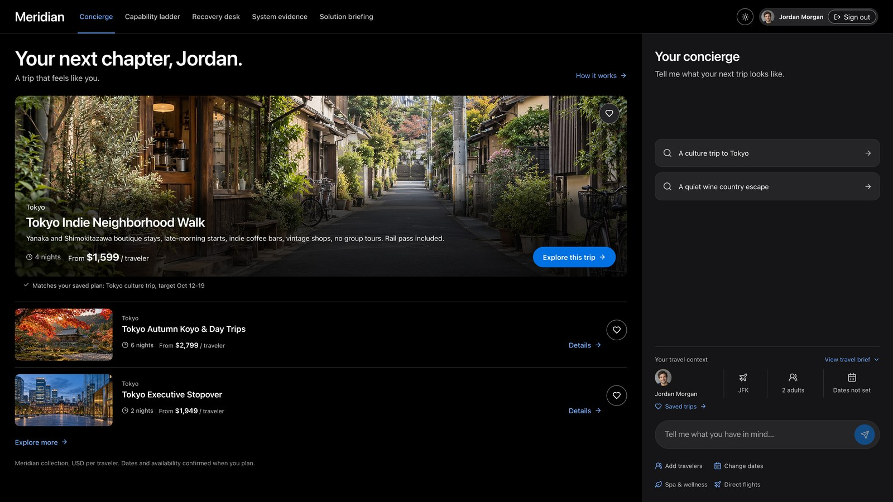
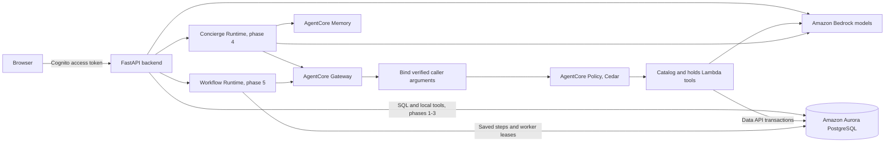

# Meridian: stateful agentic AI on Amazon Aurora, MCP and AgentCore

<p align="center">
  <a href="https://github.com/aws-samples/sample-stateful-agentic-ai-workflows-aurora-mcp-agentcore/actions/workflows/application-ci.yml"></a>
  <a href="LICENSE"></a>
  <a href="#prerequisites"></a>
  <a href="#prerequisites"></a>
  <br>
  <a href="https://aws.amazon.com/rds/aurora/"></a>
  <a href="https://aws.amazon.com/bedrock/agentcore/"></a>
  <a href="https://strandsagents.com"></a>
  <br>
  <a href="https://modelcontextprotocol.io"></a>
  <a href="https://aws.amazon.com/cognito/"></a>
  <a href="https://react.dev"></a>
  <a href="https://aws.amazon.com/cdk/"></a>
</p>

Meridian is the reference application for **DAT307-R1: Build stateful agentic AI workflows
with Aurora, MCP, and AgentCore**. Follow a travel request from a parameterized SQL query to a
governed action, then stop a worker and recover its saved progress.

<p align="center">
  
</p>

The catalog and travelers are fictional. Holds and confirmations update Meridian's database.
The recovery scenario starts with a traveler reporting a canceled flight; the application has
no airline, supplier, payment or real reservation integration.

**Start here:** [Five phases](#five-phases) | [Architecture](#architecture) |
[Run locally](#quick-start) | [Deployment](#deploy-to-your-account) |
[Verification](#tests-and-evidence) | [Production guidance](#production-implementation-scalability-and-operational-resilience) |
[Costs and cleanup](#costs-and-clean-up)

> [!IMPORTANT]
> Running the application uses billable AWS services. This is a reference application for
> learning and evaluation. Deploy the signed-in `jwt` configuration to demonstrate the full
> traveler identity boundary. The default `iam` configuration authenticates workloads and
> trusts their traveler arguments; it does not provide the same end-user guarantee.

## Five phases

The live capability ladder deliberately starts with deterministic SQL and MCP routing. The
first model-driven agent appears in Phase 3. Phase 5 uses deterministic Strands Graph steps.

| Phase | What changes | Entry point and evidence |
| --- | --- | --- |
| **1. SQL** | Parameterized catalog filters through the RDS Data API | [`sql_search` in chat.py](meridian/backend/routers/chat.py), SQL and bound values in the activity trace |
| **2. MCP** | The same business operations become named tools with typed inputs | [`mcp_search`](meridian/backend/routers/chat.py), [MCP server](meridian/backend/mcp/concierge_server.py), tool arguments and returned records |
| **3. Retrieval** | A Strands agent combines MCP reads with vector and full-text retrieval, then reranks candidates | [Retrieval agent](meridian/backend/agents/phase_03_retrieval/), [hybrid pipeline](meridian/backend/retrieval/hybrid.py), candidate and ranking spans |
| **4. Governed application** | The Concierge moves to AgentCore Runtime; Gateway, Policy and Lambda govern its tools | [Backend adapter](meridian/backend/agents/phase_04_production/), [Runtime](meridian/meridian_agentcore/app/MeridianConcierge/), Gateway refusals and committed booking receipts |
| **5. Durable workflow** | A separate Runtime executes a Strands Graph with review pauses, saved steps, leases and recovery | [Workflow](meridian/backend/agents/phase_05_workflow/), `workflow_snapshots`, `journey_executions`, stable hold identities and action audit rows |

The Phase 1 and 2 agent definitions are reference examples; the live UI calls the deterministic
router paths above. See the [phase guides](meridian/backend/agents/README.md) and the
[session readiness review](meridian/docs/DAT307_READINESS.md) for the complete map.

## Architecture



This diagram shows the `jwt` release with `MERIDIAN_GATEWAY_ENFORCEMENT=both`. The backend verifies the access token; each Runtime and
the Gateway also have JWT authorizers. The interceptor binds `travelerId` and `verifiedSubject`
to token claims. Cedar checks that binding and the action's limits. The holds Lambda then checks
its workload grant, pins the database transaction to that traveler and invokes bounded SQL
functions under row-level security (RLS).

### State and failure guarantees

| Concern | Implementation | Boundary |
| --- | --- | --- |
| Traveler context | Aurora profiles, preferences and conversations; Concierge session context in AgentCore Memory | Conversation memory does not make business actions durable. |
| Saved progress | Strands Graph snapshots in `workflow_snapshots` | A failed snapshot write can cause the preceding step to run again. |
| Worker ownership | Expiring leases and execution checks | A replacement worker acquires ownership; a stale execution cannot commit its governed hold. |
| Duplicate holds | Stable `(journey_id, hold_request_id)`, unique constraints and committed-result lookup | Retry the same intent with the same ID. Reuse never extends its original expiry. A new intent requires new consent. |
| Inventory | Allocation and confirmation share a transaction-scoped advisory lock; expiry is checked after waiting | A late confirmation cannot reclaim seats already allocated to another hold. |
| Commit uncertainty | A lost commit reply returns an unknown outcome; the next attempt reads the saved result | A transport error is not proof that an action failed. |
| Action evidence | `booking_action_audit` is inserted in the business transaction | The booking and its application audit record commit together. Service logs are needed to corroborate authorization. |

**Resuming a workflow and making an action idempotent solve different problems.** A saved step
avoids repeating completed computation. A stable request identity prevents a repeated action
from creating another booking when execution stops between the commit and the saved step.

The application's holds are database reservations only. Confirmed Hold and Confirm buttons
cause the platform to execute the exact approved terms through Gateway; the model narrates the
result. Missing inventory, unknown packages and tool failures must not become invented success.

### Retrieval boundaries

The hybrid pipeline merges vector and full-text candidates, reapplies shared catalog filters,
then reranks the surviving records. Missing catalog rows are dropped. Explicit minus terms in the retrieval tool query,
such as `Tokyo -nightlife`, apply to both candidate sources. Natural-language preferences are
relevance signals unless the code implements a corresponding structured constraint; ranking is
not a guarantee of dietary, accessibility or other real-world suitability.

### Database access

Application paths use the **RDS Data API**. Each scoped transaction carries the same transaction
ID, uses `SET LOCAL ROLE` and transaction-local traveler settings, and commits or rolls back as
one unit. HTTP connection reuse is not an application-managed PostgreSQL connection pool.
The direct psycopg examples are separate from this deployed path.

Use the master login for schema administration only; it bypasses RLS. Deployed services use
non-owner, `NOBYPASSRLS`, `NOINHERIT` logins. After migration 029, service roles cannot directly
insert, update or delete booking tables, and only `meridian_gateway` can execute the bounded
hold, confirmation and release functions. See [service logins](meridian/docs/OPERATIONS.md#service-logins).

## Prerequisites

- Python and Node.js matching [`meridian/.python-version`](meridian/.python-version) and
  [`meridian/.nvmrc`](meridian/.nvmrc). Install Python dependencies from the hashed locks and Node
  dependencies with `npm ci`.
- AWS credentials for a sandbox account, and permission to provision the resources in the
  [operations guide](meridian/docs/OPERATIONS.md). The local web app still calls live AWS services.
- Amazon Aurora PostgreSQL with the RDS Data API, pgvector and Secrets Manager credentials.
- Amazon Bedrock access to the model IDs configured in
  [`.env.example`](meridian/.env.example) and the
  [AgentCore template](meridian/meridian_agentcore/agentcore/agentcore.template.json).
  Confirm model availability and inference-profile permissions in your target Region.
- Phases 4 and 5 require deployed AgentCore resources. Packaging uses `uv` and the pinned
  `@aws/agentcore` CLI specified in the [deployment runbook](meridian/docs/AGENTCORE_DEPLOY_RUNBOOK.md).
- The supplied Cognito test-user seeding flow uses macOS Keychain. Other platforms need an
  equivalent credential provisioning flow; the release CLI itself is invoked through pinned `npx`.

## Quick start

### 1. Install local dependencies

From the repository root:

```bash
cd meridian
python3.13 -m venv venv
source venv/bin/activate
python -m pip install --require-hashes -r requirements.txt
test -e .env || cp .env.example .env
```

`seed_data.py` calls Amazon Bedrock when preparing catalog embeddings.

Set the Region, Aurora cluster, database and secret references in `.env`. Keep credentials and
account-specific configuration out of Git.

### 2. Prepare AWS resources and choose authentication

Follow [Prepare the database](meridian/docs/OPERATIONS.md#prepare-the-database). Initialize and
seed only an empty database. List pending migrations, dry-run **one named migration**, inspect
its result, then apply that migration. Existing installations must follow the
[026-029 release order](meridian/docs/DAT307_RELEASE.md); do not apply all four before upgrading
the running application.

The launcher below selects the provisioned **backend service login** through
`AURORA_BACKEND_SECRET_ARN`. When launching Uvicorn directly instead, set that process's
`AURORA_SECRET_ARN` to the backend service secret; the database client reads that variable.
Never launch application traffic with the master secret.

| Mode | Use it for | Setup |
| --- | --- | --- |
| `iam` | Local exploration with a trusted workload and seeded traveler grants | Loopback backend, AWS credentials, explicit workload-to-traveler binding |
| `jwt` | The signed-in traveler and cross-traveler isolation walkthrough | Cognito, backend verification, JWT authorizers on both Runtimes and Gateway, request interceptor, Cedar binding policy and service logins |

Deploy AgentCore for Phases 4 and 5 using the
[runbook](meridian/docs/AGENTCORE_DEPLOY_RUNBOOK.md), then synchronize the returned endpoint
configuration using its documented steps. A healthy database alone does not establish that the
Runtimes, Gateway or policies are ready.

### 3. Start the backend and frontend

Backend, from `meridian/` with the virtual environment active:

```bash
python scripts/run_local.py
```

Frontend, from a second terminal at the repository root:

```bash
cd meridian/frontend
npm ci
VITE_API_ORIGIN=http://127.0.0.1:8013 npm run dev -- --host localhost --port 5173 --strictPort
```

Open <http://localhost:5173/showcase>. Check `/api/health` and the UI's configuration indicators.
`"workflow_runtime_configured"` is `false` until you deploy and synchronize the Workflow
endpoint. The snapshot store is reported as `"snapshot_store": "Aurora workflow_snapshots"`.
Keep the local open/shared-token modes on loopback. Use the signed-in release for hosted access.

### Run from VS Code

After completing setup, open [`meridian.code-workspace`](meridian.code-workspace), install its
recommended Python extensions, and select **Meridian: local app** in Run and Debug. Press **F5**.
The workspace starts Vite at `http://localhost:5173` and the backend on port 8013, then opens the showcase.
`scripts/run_local.py` selects `AURORA_BACKEND_SECRET_ARN` for that process; it leaves the
administrator settings in `.env` unchanged and refuses to launch without the service secret.
It preserves the configured authentication mode. Local sign-in also needs the Cognito frontend
settings and the exact registered callback `http://localhost:5173/showcase`.
Use `localhost`, not `127.0.0.1`, in the browser: Cognito treats them as different callback
URLs. A different host or port causes `redirect_mismatch`; return to the registered address
and start sign-in again.

Use **Tasks: Run Task > Meridian: check local configuration** for an offline settings check.
Stop the debugger to stop the backend; use **Tasks: Terminate Task > Meridian: frontend** to
stop Vite. Port conflicts fail explicitly. The workspace assumes the macOS/Linux `venv/bin/python`
layout shown above; Windows users must select `venv\Scripts\python.exe` in the workspace settings
and launch configuration.

## Try the reference app

| View | Exercise | Inspect |
| --- | --- | --- |
| **Capability ladder** | Run each phase's suggested prompts | SQL parameters, MCP arguments, retrieved IDs and ranking |
| **Concierge** | Find a trip, request a hold, then confirm it | Exact terms, Gateway outcome and saved booking receipt |
| **Recovery desk** | Report a canceled Tokyo flight, review the shortlist, stop the Runtime session, then resume | Saved step, new execution, unchanged hold request ID and one booking |
| **System evidence** | Open the records for that journey | Snapshots, leases, access decisions and business rows |
| **Solution briefing** | Trace the application architecture | Where identity, policy, RLS and recovery apply |

The [prompt guide](meridian/README.md#prompts) gives the precise prompts. The
[failure exercises](meridian/docs/OPERATIONS.md#exercise-recovery-failures) intentionally stop
workers or lose replies; run them only in a disposable environment. Capture evidence before a
rehearsal reset: the administrative reset deletes selected bookings and their action audit rows.

## Deploy to your account

| Component | Entry point | Instructions |
| --- | --- | --- |
| Aurora | [`meridian/infra/bin/meridian-aurora.ts`](meridian/infra/bin/meridian-aurora.ts) | [Provision Aurora](meridian/docs/OPERATIONS.md#provision-aurora) |
| Runtime, Gateway, Memory and Policy | [AgentCore project](meridian/meridian_agentcore/) | [Deployment runbook](meridian/docs/AGENTCORE_DEPLOY_RUNBOOK.md) |
| Optional hosted web app | [`scripts/publish.py`](meridian/scripts/publish.py) | [Publish the web app](meridian/docs/OPERATIONS.md#publish-the-web-app) |
| Existing installation upgrade | Migrations 026-029 and coordinated application release | [DAT307 release gates](meridian/docs/DAT307_RELEASE.md) |

The hosted path uses CloudFront, S3 and an existing App Runner service. The repository does not
create that App Runner service. Hosting is optional; AWS data and agent services are required
for the corresponding local application features.

## Tests and evidence

Backend, from `meridian/`:

```bash
venv/bin/python -m pip install --require-hashes -r requirements-ci.txt
venv/bin/python -m pip install --require-hashes --no-deps -r requirements-runtime-tests.txt
venv/bin/python -m pip install --require-hashes -r examples/langgraph/requirements.txt
PYTHON_DOTENV_DISABLED=1 venv/bin/python -m pytest -m "not database" tests examples/langgraph/tests
```

The unit-test guard blocks TCP connections and supplies fake AWS credentials. The local SQL tests
create and remove their own socket-only PostgreSQL cluster and databases. They need PostgreSQL
server binaries and pgvector; set `MERIDIAN_PG_CONFIG` to that installation's `pg_config`. They
report a skip when those prerequisites are absent. Tests marked `database` access a configured
live Aurora cluster and can write data; do not include them in an offline check.

Frontend, from `meridian/frontend/`: run `npm ci`, `npm run lint`, `npm run typecheck`,
`npm run test:run`, `npm run build` and `npm run test:accessibility`.

The [CI workflow](.github/workflows/application-ci.yml) also checks infrastructure synthesis,
dependency advisories and each Runtime's exact dependency environment. The isolated
[`check_runtime_contract.py`](meridian/scripts/check_runtime_contract.py) exercises real MCP
stdio and Strands saved-step recovery without AWS; the backend lock alone does not test the
Runtime's MCP override.

**Evidence has different strengths.** UI spans and `agent_audit_log` are application reports;
a hard-killed process may never write its final turn row. A workflow that finds an existing
committed result need not call the target again or create another action row.
`booking_action_audit` commits with the action and carries caller, workload, request and
service correlation IDs. It does not
constitute a service-issued Cedar decision. Correlate it with Gateway/interceptor/Lambda logs
and the stored booking. Administrators remain able to alter database records.

Historical screenshots and recordings illustrate the captured release. They do not certify
an upgrade. The [readiness review](meridian/docs/DAT307_READINESS.md) identifies the remaining
live proofs and their expected outcomes.

## Production implementation, scalability and operational resilience

Meridian demonstrates production mechanisms, but it is not a capacity certification or a
complete production operating model. Set service-level objectives, recovery point and recovery
time objectives, and an expected traffic profile before adapting it for customer workloads.

| Area | Implemented here | Production work to complete |
| --- | --- | --- |
| Identity and least privilege | JWT validation at backend, Runtimes and Gateway; trusted argument binding; Cedar; service logins and transaction-scoped RLS | Use your identity lifecycle, tenant model and credential rotation. Restrict direct Lambda invocation and service-secret access, which sit outside the traveler-facing boundary. Re-run cross-traveler and direct-access tests after IAM or policy changes. |
| Horizontal scaling | Separate hosted backend and Runtimes; Aurora snapshots and leases coordinate workflow attempts | Load-test concurrent journeys and hot inventory keys. Match App Runner scaling, Runtime quotas and Lambda concurrency to database and model capacity. An SDK HTTP pool is not a PostgreSQL pool or a capacity reservation. |
| Database capacity | One Serverless v2 writer, 0.5-16 ACUs in the supplied CDK template; shared inventory locks prevent oversubscription | Measure query latency, lock waits, ACU utilization and Data API throttling. Tune vector/full-text indexes and candidate limits using representative data. Decide whether a standby reader and failover topology meet your availability objectives; the template creates no reader. |
| Retries and backpressure | Bounded retries, stable action IDs, committed-result lookup, worker leases and fenced writes | Apply admission limits per tenant and workload. Retry only transient failures with a bounded budget; preserve the same business intent on ambiguous commits. Do not turn a timeout into a new booking request. |
| Long-running work | Streamed responses, saved progress and explicit outcome readback | Treat HTTP disconnection as loss of observation. Work after a web request is best effort; persist required follow-up work durably. Test scale-in, expired caller tokens, lost replies and failed snapshot writes under load. |
| Availability and disaster recovery | Encrypted Aurora storage, deletion protection and seven-day backup retention in the template | Restore into an isolated environment and measure recovery time. Test writer failover and resume with the original IDs. Define regional recovery and backup retention for your business; this sample does not implement a cross-Region recovery plan. |
| Observability and audit | Health checks, application traces, service correlation IDs, transactional action audit and best-effort turn summaries | Set alarms and owners for error rate, latency, throttling, lease age, snapshot failures and unresolved action outcomes. Correlate application records with native service logs. Define access, retention and immutable export requirements; administrator-editable rows alone are not tamper-proof evidence. |
| Safe releases | Hashed dependencies, CI, staged Runtime bundles, migration sequencing, deployment readback and failure proofs | Use separate environments, reviewed changes, a maintenance procedure and measured rollback criteria. Follow the 026-029 cutover order; old writer code is incompatible with the final revoked grants. |

The current write path has deliberate serialization points: one active worker per workflow
thread and locks on the relevant inventory keys. Adding workers can increase independent
journey throughput; it cannot remove contention for the same seats. Measure p95/p99 latency,
success and refusal rates, token usage and cost per completed journey before increasing limits.
No requests-per-second or concurrent-user target has been established by the functional tests.

For operational procedures, use [waits, retries and readback](meridian/docs/OPERATIONS.md#waits-retries-and-readback),
the [stateful architecture](meridian/docs/STATEFUL_ARCHITECTURE.md), and the
[release and failure matrix](meridian/docs/DAT307_RELEASE.md). For an unknown action outcome,
look up the original intent and booking first. Capture evidence before an administrative reset;
resetting a booking deletes its associated action audit and is not a recovery procedure.

## Costs and clean up

Amazon Aurora compute, storage and backups incur charges while provisioned. Model inference,
AgentCore, Lambda, logs, Secrets Manager and optional web hosting add usage or retained-resource
costs. Read each service's current pricing before provisioning; the repository does not enforce
an account spending limit.

### Cost planning table

Rates and meters were checked on **November 7, 2026**. Estimate in your target Region using the
linked pricing pages and [AWS Pricing Calculator](https://calculator.aws/). Model selection,
Runtime compute generation, traffic, session duration, storage and retention change the result.
The table excludes credits, free-tier allowances, discounts, taxes and support charges.

| Component | Usage to budget | Estimate and cost control |
| --- | --- | --- |
| [Aurora Serverless v2](https://aws.amazon.com/rds/aurora/pricing/) | ACU-hours for every instance, storage, backup storage and applicable I/O | Sum average ACUs x hours x the regional ACU rate. The template's nonzero 0.5-ACU floor does not auto-pause. Account separately for retained snapshots and any added readers. |
| [Bedrock models](https://aws.amazon.com/bedrock/pricing/) | Input/output tokens, embedding input and rerank queries/chunks | Measure actual model calls per journey, including retries and catalog seeding. Apply the selected model and inference-tier rates; a user turn can cause several model calls. |
| [AgentCore Runtime](https://aws.amazon.com/bedrock/agentcore/pricing/) | Metered CPU and memory consumption for both Runtimes | Use the rate for the deployed compute generation and observed session usage. Include review pauses and memory retention in measurements rather than pricing only model latency. |
| [AgentCore Gateway, Policy and Memory](https://aws.amazon.com/bedrock/agentcore/pricing/) | Tool discovery/calls, policy evaluations, conversation events and memory operations | Count each metered operation, including retries and discovery. Workflow snapshots live in Aurora; Concierge conversation memory is a separate AgentCore cost. |
| [Lambda](https://aws.amazon.com/lambda/pricing/) | Requests and duration x configured memory | Include targets, request interception and Cognito hooks. Bound timeout and concurrency; a denied tool call can still incur upstream authorization work. |
| [Cognito](https://aws.amazon.com/cognito/pricing/) and secrets | Monthly active users, selected Cognito tier, secret storage and API calls | Include service-login secrets and any configured messaging or security features. See [Secrets Manager pricing](https://aws.amazon.com/secrets-manager/pricing/). |
| [App Runner](https://aws.amazon.com/apprunner/pricing/) and optional hosting | Provisioned memory, active CPU, S3 storage/requests, CloudFront traffic and container images | Local web serving avoids hosted web costs, but still uses AWS data and agent services. App Runner's provisioned memory can incur idle charges. See [S3](https://aws.amazon.com/s3/pricing/), [CloudFront](https://aws.amazon.com/cloudfront/pricing/) and [ECR](https://aws.amazon.com/ecr/pricing/). |
| [CloudWatch](https://aws.amazon.com/cloudwatch/pricing/) and networking | Log/trace ingestion, retention, queries, alarms and data transfer | Set retention and sampling deliberately. Include NAT gateways, endpoints or cross-Region transfer only if your chosen topology adds them. |

**Compute-only illustration:** one Aurora Standard writer in US East (N. Virginia), held at
0.5 ACU for 730 hours, at the published $0.12/ACU-hour example rate, costs
`0.5 x 730 x $0.12 = $43.80`. This is not the full application price or an upper bound: it
excludes scaling above the floor and every other row in the table.
[Aurora pricing example](https://aws.amazon.com/rds/aurora/pricing/).

Create budget alerts and resource tags before provisioning, then compare measured usage with
the estimate after a representative rehearsal. Budget alerts do not stop spending. Retained
backups, logs, secrets and images can continue to incur charges after compute is removed.

### Clean up

Remove resources in reverse dependency order using the runbooks:

1. [Hosted web application](meridian/docs/OPERATIONS.md#publish-the-web-app), if created.
2. [Sign-in resources and service-login integrations](meridian/docs/OPERATIONS.md#roll-back-the-service-logins-and-sign-in).
3. [AgentCore resources](meridian/docs/AGENTCORE_DEPLOY_RUNBOOK.md#tear-down), including separately provisioned targets and secrets.
4. [Aurora](meridian/docs/OPERATIONS.md#provision-aurora), preserving a final snapshot until you no longer need the data.

Review retained snapshots, log groups, secrets, S3 objects and images afterward. Do not remove a
shared CDK bootstrap stack or shared infrastructure as part of this application's cleanup.

## Documentation

| Guide | Purpose |
| --- | --- |
| [Application README](meridian/README.md) | Screens, prompts, API and configuration |
| [Code structure](meridian/STRUCTURE.md) | Request paths and module responsibilities |
| [Stateful architecture](meridian/docs/STATEFUL_ARCHITECTURE.md) | Memory, saved progress and transactions |
| [Operations](meridian/docs/OPERATIONS.md) | Provisioning, deployment, recovery and teardown |
| [DAT307 readiness](meridian/docs/DAT307_READINESS.md) | Findings, claim-to-evidence map and failure matrix |
| [DAT307 release](meridian/docs/DAT307_RELEASE.md) | Migration order, acceptance gates and rehearsal reset |
| [Documentation index](meridian/docs/README.md) | All supporting guides |

## Security and contribution

Review the [governance boundary](meridian/README.md#governance-boundary) before exposing the API.
RLS constrains database roles and transaction scope; it does not cryptographically authenticate
a JWT. Direct access to privileged Lambda invocation, service credentials or the master login
is a separate administrative trust boundary.

Report security issues through the [AWS vulnerability reporting page](https://aws.amazon.com/security/vulnerability-reporting/),
not a public issue. For contributions, see [CONTRIBUTING.md](CONTRIBUTING.md) and the
[Code of Conduct](CODE_OF_CONDUCT.md).

## License

MIT-0; see [LICENSE](LICENSE). Third-party images and icons retain their own terms in [NOTICE](NOTICE).
